Cesium sample
=============

This is a sample project to be used with coreDS Unreal and Unreal Engine 5.2 or later. You can request a `free trial <https://www.ds.tools/contact-us/trial-request/>`__.

coreDS Unreal must already be installed and activated to use this project. The sample needs three plugins, none of which is enabled by default; the sample's ``coreDSUnreal_Cesium.uproject`` already enables them:

- coreDS Unreal (``coreDSModule``).
- coreDS Unreal Cesium support (``coreDSCesiumSupport``), installed with coreDS Unreal. It converts locations between the Cesium world and geocentric (ECEF) coordinates. Without it, coreDS Unreal logs an error each time a level containing a CesiumGeoreference actor starts, and locations are sent in Unreal coordinates instead of ECEF.
- The `Cesium for Unreal plugin <https://cesium.com/platform/cesium-for-unreal/>`__ (``CesiumForUnreal``), which must also be installed. With Unreal Engine 5.2, use Cesium for Unreal 2.11.

If you copy this setup to your own project, enable these plugins in Edit > Plugins, or list them in your ``.uproject``.

Cesium ion access token
-----------------------

The sample streams Cesium World Terrain and Bing Maps imagery from `Cesium ion <https://ion.cesium.com/>`__, which requires an access token of your own; the sample does not ship one. The first time you open the project, open the Cesium panel (Window > Cesium), sign in to Cesium ion, and use the Token button of the panel to create or select the token of the project. Until then, the globe stays empty and Cesium logs errors when loading the tileset.

Cesium keeps the token in ``Content/CesiumSettings/CesiumIonServers/CesiumIonSaaS.uasset``, which Cesium creates when the project opens. The sample's ``.gitignore`` excludes this folder, so that your token is not committed.

This sample showcases the Automatic Object Management mode together with the coreDS Unreal georeferencing support: coreDS Unreal finds the CesiumGeoreference actor of the level and converts the coordinates accordingly. The georeferencing helper in use is selected by "GeoReferencing System In Use" in the Scene category of the coreDS settings (``ACesiumGeoreference`` in this sample).

The Automatic Mode manages the complete life cycle of discovered objects, which makes it easy to receive information from DIS or HLA.

Each kind of entity is shown as a simple colored shape: blue cones for aircraft, green boxes for ground vehicles, cyan cylinders for ships and submarines, small red spheres for munitions, yellow cylinders for life forms, and orange spheres (the ``coreDSSphere`` Blueprint) for everything else.

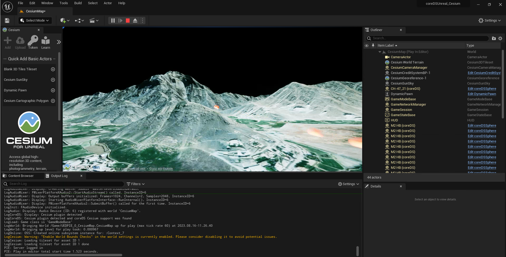

Please refer to the :doc:`Automatic Mode sample </Samples/coreDSUnreal_Sample_AutomaticMode/README>` to learn more about selecting the actor to spawn from the received EntityType.

This sample project uses the following coreDS concepts:

- Connect
- Disconnect
- Receive Update Object (receive EntityStatePDU, or DiscoverObjectInstance and ReflectAttributeValues)
- Delete Objects (EntityStatePDU timeout or RemoveObjectInstance)

The sample is already configured. The next sections go over the steps required to start from scratch.

Getting started
---------------

The first step is to configure coreDS Unreal to enable the Automatic Mode.

This configuration is in Edit > Project Settings > Plugins > coreDS, in the Automatic Mode category.

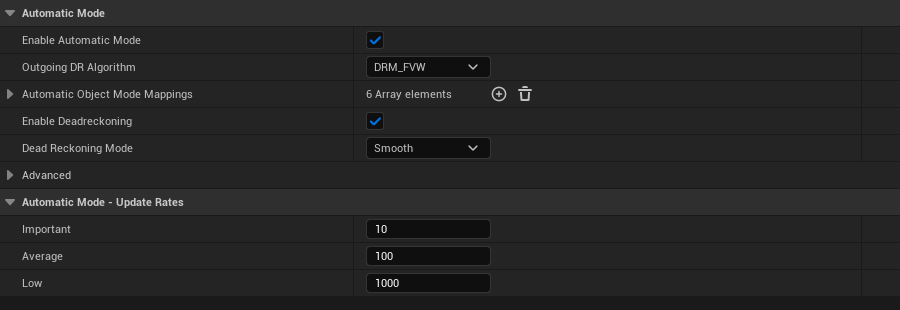

Each entry of "Automatic Object Mode Mappings" has an "Object Class Selector": a list of regular expressions. When a received object's ObjectClassSelector value matches one of them, the entry's "Actor to Spawn" is spawned. The entries are checked in order and the first match is used, so place your higher priority entries first.

For each entry, you can enable or disable collisions and physics. We recommend leaving the collision and physics disabled at first, and enabling them once you have confirmed that the objects are spawned correctly.

In this sample, the ObjectClassSelector is the EntityType written as ``kind.domain.country.category.subcategory.specific.extra`` (``1.2.225.1.3.0.0`` for an F-16), and the entries select the actor from the kind and the domain:

.. list-table::
   :header-rows: 1
   :widths: 30 25 45

   * - Entities
     - Object Class Selector
     - Actor to Spawn
   * - Air platforms (kind 1, domain 2)
     - ``^1[.]2[.]``
     - ``Entities/coreDSAircraft``: blue cone, pointing forward
   * - Land platforms (kind 1, domain 1)
     - ``^1[.]1[.]``
     - ``Entities/coreDSGroundVehicle``: green box
   * - Surface and subsurface platforms (kind 1, domains 3 and 4)
     - ``^1[.]3[.]``, ``^1[.]4[.]``
     - ``Entities/coreDSVessel``: cyan cylinder, along the length of the ship
   * - Munitions (kind 2)
     - ``^2[.]``
     - ``Entities/coreDSMunition``: small red sphere
   * - Life forms (kind 3)
     - ``^3[.]``
     - ``Entities/coreDSLifeform``: yellow cylinder
   * - Everything else
     - ``.``
     - ``coreDSSphere``: orange sphere

``[.]`` matches a dot: it is the same as ``\.``, without the backslash that the ``.ini`` file would need to escape. The last entry, ``.``, matches anything, so it must stay last. To show your own models, set "Actor to Spawn" (or "Mesh to Spawn") of an entry, or add entries for more specific EntityTypes above the generic ones. The shapes use ``Entities/M_coreDSEntity``, an unlit material whose color is the ``Color`` parameter of each material instance, so the entities stay visible from far away.

The Cesium world automatically flies to the location of the first discovered entity. This is done in the Level Blueprint.

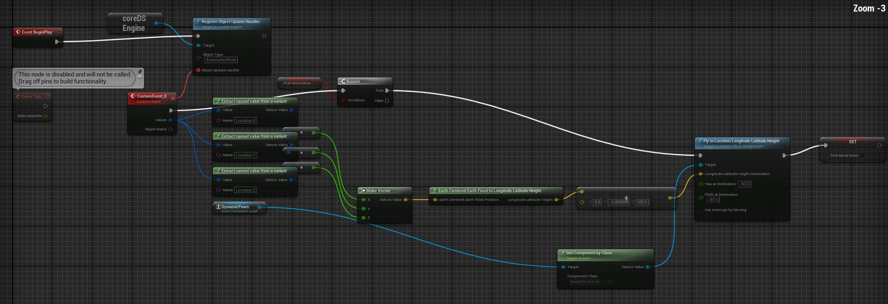

To do this, we register an "Object Update Handler" to receive the updates of the "AutomaticMode" object type. "AutomaticMode" is a built-in object type defined by coreDS Unreal. The first time an update is received, while "First Move Done" is still true, we fly the camera to the received object; then "First Move Done" is cleared so the move only happens once:

- The location of the received object, in ECEF, is converted to longitude, latitude and height ("Earth Centered Earth Fixed to Longitude Latitude Height").
- An offset is added to it, so the camera does not end on the object: ``(0, -0.000898, 100)`` puts it 100 m south of the object (0.000898 degree of latitude) and 100 m above it.
- "Fly to Location Longitude Latitude Height" of the "Cesium Fly To Component" of the ``DynamicPawn`` flies there, with a yaw of -90 (facing north) and a pitch of -45 (looking 45 degrees down): the object is in the middle of the view, about 140 m away. The yaw and the pitch are relative to an East-South-Up frame: a yaw of 0 faces east, -90 north.

To see the object from farther away, scale the offset: ``(0, -0.0018, 200)`` is twice as far.

coreDS Unreal manages the complete object life cycle. Connect and disconnect are also taken care of automatically.

coreDS Unreal supports dead reckoning (DR), and it is enabled in this sample. You can disable it by unchecking "Enable Deadreckoning" in the Automatic Mode category of the coreDS settings.

For dead reckoning to work, it must be enabled and the DR properties must be mapped correctly (see below).

The Cesium support uses the "Level North Yaw" setting of the Scene category: the Unreal yaw of north in the level. Its default, -90, is the Cesium and GeoReferencing plugins convention (north is -Y, east is +X). For a level built with north on +X, set it to 0.

The next step is to configure an actual connection with a distributed simulation protocol. coreDS supports HLA (High-Level Architecture) and DIS (Distributed Interactive Simulation).

You can open the configuration window either by running the game or from Tools > Distributed Simulation > coreDS Unreal > Show coreDS UI.

This sample comes with 2 preconfigured configurations, in ``Content/coreDS``. Both only receive: the sample displays the remote entities and publishes nothing.

- ``DIS 7.coreDS``: DIS 7 (IEEE 1278.1-2012), with the object model ``DIS_V7_IEEE_1278.1-2012.xml``.
- ``HLA 1516e RPR-FOM 2.0.coreDS``: HLA 1516e (IEEE 1516-2010) with the RPR FOM 2.0 (SISO-STD-001.1-2015), ``RPR_FOM_v2.0_1516-2010.xml``.

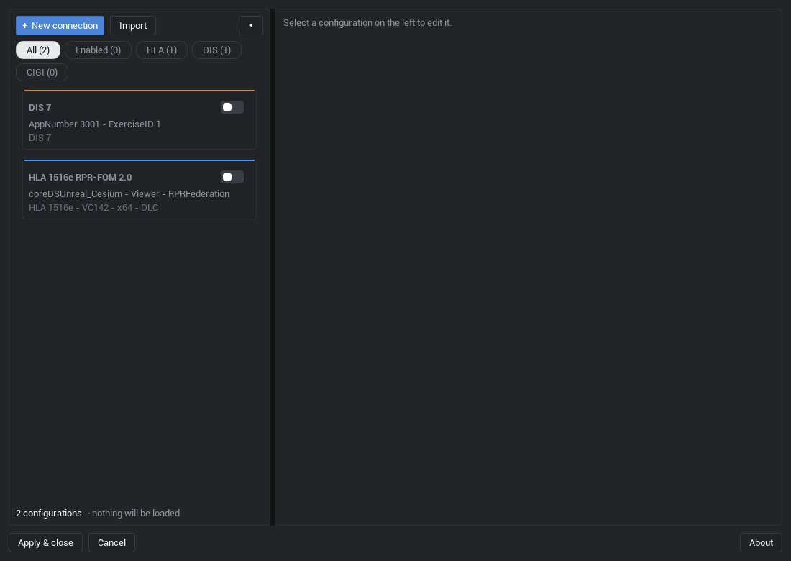

The FOM files are given by their file name only, so the configurations work on any computer without changes: coreDS finds ``RPR_FOM_v2.0_1516-2010.xml`` next to the configuration, in ``Content/coreDS``, and ``DIS_V7_IEEE_1278.1-2012.xml`` in the folder of the coreDS libraries, where coreDS Unreal installs it.

Let's take a look at each configuration.

(Directly jump to the `High-Level Architecture (HLA)`_ configuration.)

Distributed Interactive Simulation (DIS)
----------------------------------------

The network adapter is ``0.0.0.0``: the system chooses it, and the PDUs are received on every adapter, on port 3000. If your computer has several adapters, or if you send on the DIS network from the same configuration, click the "Network Interface Address" drop-down list and select the adapter of the DIS network, and set the destination address (usually the broadcast address of that network).

The configuration window shows ``0.0.0.0`` in red, as an adapter not found on this computer: the window only knows the adapters it detected. coreDS accepts ``0.0.0.0`` and receives on every adapter. Selecting your adapter removes the warning.

With DIS 7, an entity is discovered by its first Entity State PDU; its Entity State Update PDUs then update it through the same mapping.

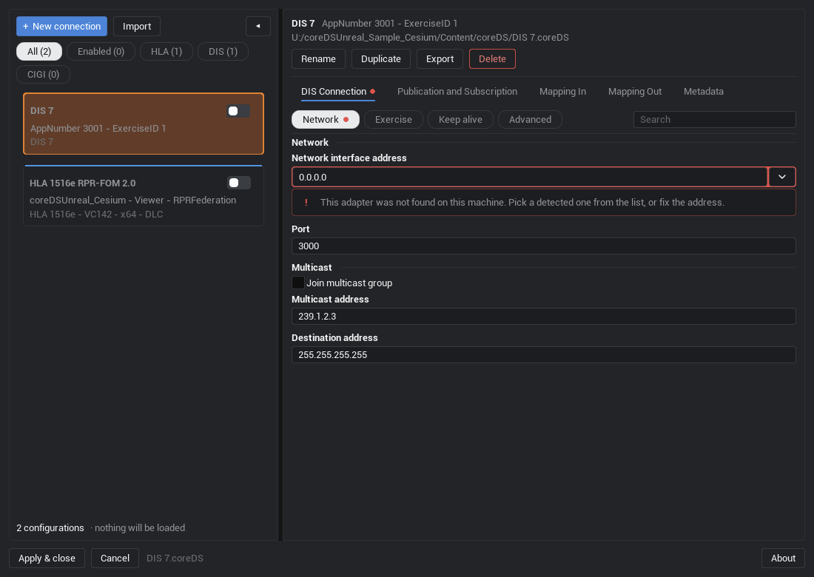

Even if DIS does not explicitly support subscriptions, coreDS supports incoming filtering. First, we must let coreDS know that we want to receive the EntityStatePDU: subscribe to "Entity State".

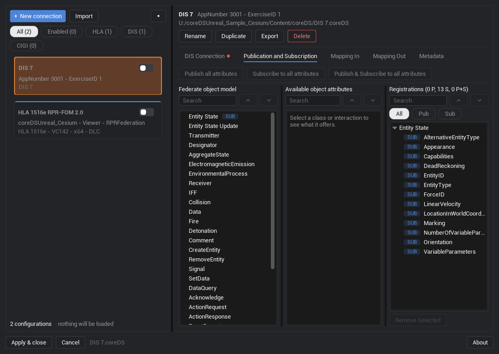

Receiving
~~~~~~~~~

Then comes the mapping configuration. To receive, we care about the "Mapping In".

The first step is to map a local object to a protocol object: click "+", then link the remote "Entity State" to the local "AutomaticMode". "AutomaticMode" is the built-in local object of the Automatic Mode.

Then you must map the local properties to the protocol properties. When receiving, we only map the values we are interested in:

- EntityType: when using the Automatic Mode, the ObjectClassSelector must be set: it selects the actor to spawn. It can be anything; for example, you could assign it the Marking to select the actor based on the object name. In most cases, we use the EntityType. To do so, the "On Update" script of the EntityType group is ``UseEntityTypeAsUniqueIdentifier.lua``.
- LocationInWorldCoordinates and Orientation: ``Location.X/Y/Z`` and ``Orientation.psi/theta/phi``. No conversion script is needed: the Cesium support converts between ECEF and the Cesium world.
- Marking.MarkingData: ``ActorName``, the name of the spawned actor.
- Appearance, NumberOfVariableParameters and VariableParameters: ``Appearance``, ``NumberOfParts`` and ``ArticulatedParts``, for the actors that show them.
- Dead reckoning, if it is enabled: LinearVelocity to ``DR_LinearVelocityX/Y/Z``, and DeadReckoning (algorithm, linear acceleration, angular velocity) to ``DR_Mode``, ``DR_LinearAccelerationX/Y/Z`` and ``DR_AngularVelocityX/Y/Z``.

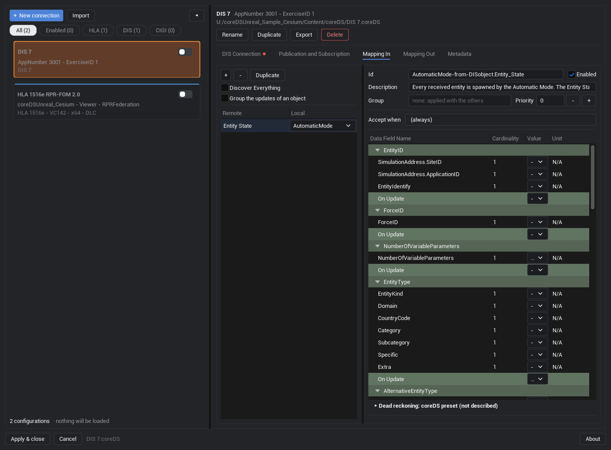

At this point, you are done. Depending on your Automatic Mode settings, each time an EntityStatePDU of a new entity is received, a new actor is spawned and coreDS Unreal handles its complete life cycle.

High-Level Architecture (HLA)
-----------------------------

Configure the connection to the correct RTI.

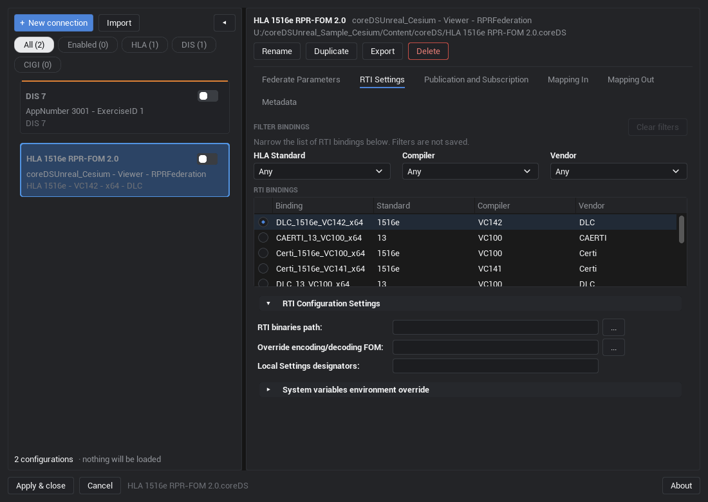

The configuration uses the ``DLC_1516e_VC142_x64`` connector, which loads the IEEE 1516-2010 Dynamic Link Compatible libraries of your RTI (``rti1516e`` and ``fedtime1516e``): they must be on the ``PATH``, or given as the RTI library path. Select the connector of your RTI vendor instead if you have one.

coreDS-based products support a wide variety of RTIs, HLA versions and binding types. It is important to select the correct RTI settings combination. Although coreDS tries to inform you at runtime if the selected combination is invalid, this is not a failsafe process: an incorrect combination can lead to an unexpected crash. Do not hesitate to contact us if you are unsure about your configuration.

Publication and Subscription
~~~~~~~~~~~~~~~~~~~~~~~~~~~~

In this sample, we subscribe to the EntityType, Spatial and Marking attributes of HLAobjectRoot.BaseEntity.PhysicalEntity. The objects of its subclasses (Platform, Aircraft, GroundVehicle, Lifeform...) are discovered as PhysicalEntity objects. The federate is neither time regulating nor time constrained, so it never holds the federation back.

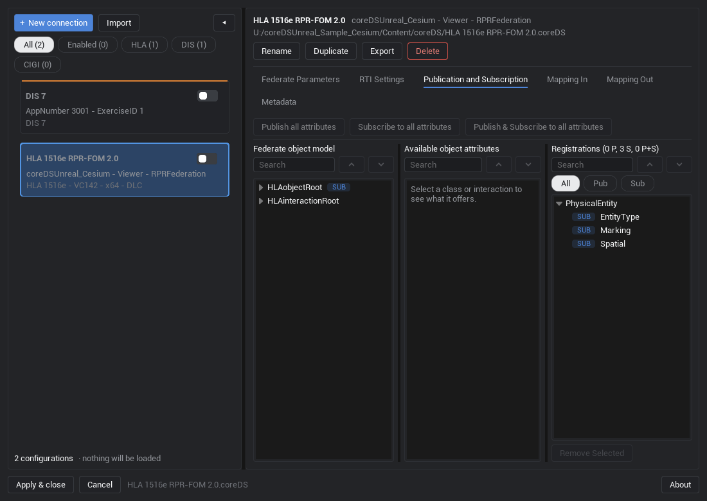

Federate Parameters
~~~~~~~~~~~~~~~~~~~

The Federate Parameters pane contains all the information required to create, join and configure a connection to the RTI, including the FOM file, ``RPR_FOM_v2.0_1516-2010.xml``. The federation is ``RPRFederation``: change it to the name of the federation you join.

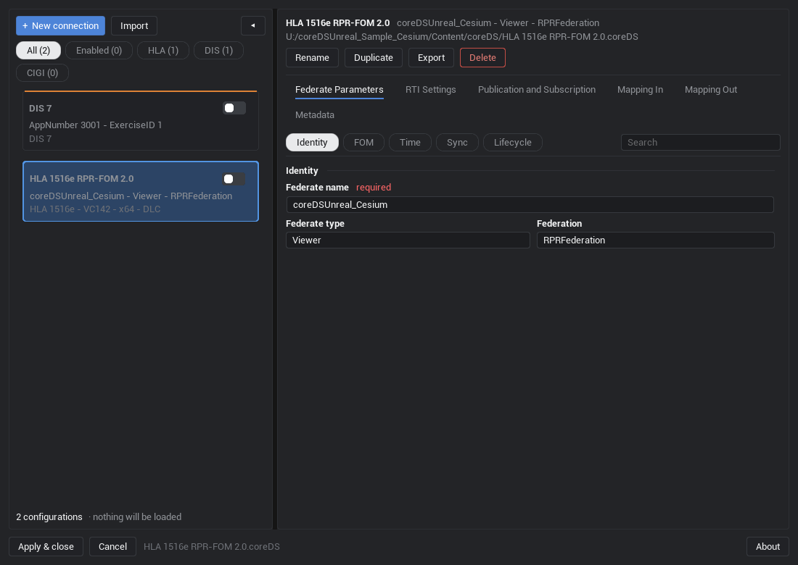

Receiving
~~~~~~~~~

Then comes the mapping configuration. To receive, we care about the "Mapping In".

The first step is to map a local object to a protocol object: click "+", then link the remote "PhysicalEntity" (``HLAobjectRoot.BaseEntity.PhysicalEntity``) to the local "AutomaticMode".

Then you must map the local properties to the protocol properties:

- EntityType: as for DIS, its "On Update" script is ``UseEntityTypeAsUniqueIdentifier.lua``, so the EntityType is used as the ObjectClassSelector.
- Spatial: WorldLocation and Orientation to ``Location.X/Y/Z`` and ``Orientation.psi/theta/phi``, with no conversion script; and, for dead reckoning, DeadReckoningAlgorithm, VelocityVector, AccelerationVector and AngularVelocity to ``DR_Mode``, ``DR_LinearVelocityX/Y/Z``, ``DR_LinearAccelerationX/Y/Z`` and ``DR_AngularVelocityX/Y/Z``. Spatial is a variant record: coreDS reads the fields of the alternative given by the DeadReckoningAlgorithm.
- Marking.MarkingData: ``ActorName``.

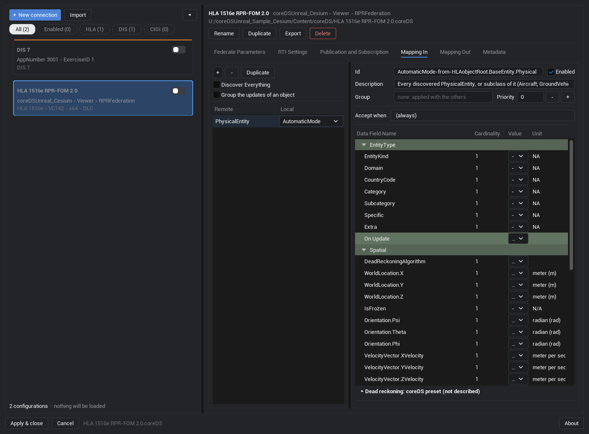

At this point, you are done. Depending on your Automatic Mode settings, each time a new PhysicalEntity is discovered, a new actor is spawned and coreDS Unreal handles its complete life cycle.
